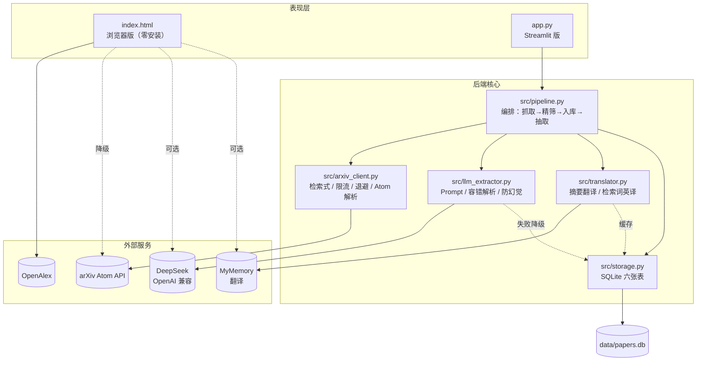

# 技术设计文档 —— 项目 TDD（Milestone 2）

| 项 | 内容 |
|---|---|
| 项目名称 | 神经网络领域文献追踪看板（NN Literature Tracker） |
| 文档版本 | v1.0 |
| 完成日期 | 2026-11-23 |
| 对应里程碑 | Milestone 2 · 架构设计 |
| 上游文档 | `研究说明.md`（PRD，需求编号 FR-xx / AC-xx 均引自该文） |

---

## 1. 设计目标与约束

| 目标 | 对应需求 | 设计手段 |
|---|---|---|
| 只抓该方向的论文 | FR-01/02 | 「服务端宽召回 + 客户端关键词精筛」两阶段检索 |
| 抓取稳定不封 IP | FR-03/11 | 模块级限流（≥3s）+ 指数退避重试 |
| 结构化输出可解析 | FR-05/07 | Few-shot + `json_object` 模式 + 三级容错解析 + 修复重试 |
| 结论可信 | FR-05/NFR-06 | evidence 溯源、链接必须原文可查、开源三态 |
| 单点失败不扩散 | FR-11/12 | 分层 try/except + 降级状态机 |
| 零密钥泄露 | FR-13/AC-10 | `.env` + `.gitignore` + 脱敏展示 |

**技术约束**（来自 AGENTS.md 第 2 节，不得擅自替换）：
Streamlit 前端 / arXiv Atom API 数据源 / DeepSeek（OpenAI 兼容）LLM / SQLite 存储 / 仅 5 个第三方依赖。

---

## 2. 系统架构

### 2.1 分层视图

```
┌──────────────────────────────────────────────────────────────┐
│  表现层  app.py  (Streamlit)                                  │
│  · 侧边栏：方向多选 / X 天 / 条数 / 是否启用 LLM              │
│  · 主区：统计指标 → 刷新摘要 → 论文卡片 → CSV 导出            │
└───────────────────────────┬──────────────────────────────────┘
                            │  run_pipeline(keys, days, max, use_llm, progress)
┌───────────────────────────▼──────────────────────────────────┐
│  编排层  src/pipeline.py                                      │
│  · 阶段一：遍历方向 → 抓取 → 精筛 → 入库                       │
│  · 阶段二：跨方向去重 → 增量 LLM 提取 → 入库                   │
│  · 汇总 PipelineStats（成功/降级/失败/耗时/错误列表）          │
└──────┬────────────────────┬───────────────────────┬──────────┘
       │                    │                       │
┌──────▼────────┐  ┌────────▼─────────┐  ┌──────────▼─────────┐
│ arxiv_client  │  │ llm_extractor    │  │ storage            │
│ · 检索式构造  │  │ · Prompt 组装    │  │ · SQLite 读写      │
│ · 限流/重试   │  │ · JSON 容错解析  │  │ · 联表查询         │
│ · Atom 解析   │  │ · 防幻觉后处理   │  │ · 抓取日志         │
└──────┬────────┘  └────────┬─────────┘  └──────────┬─────────┘
       │                    │                       │
 ┌─────▼─────┐      ┌───────▼────────┐      ┌───────▼───────┐
 │ arXiv API │      │ DeepSeek API   │      │ data/papers.db│
 │ (Atom XML)│      │ (OpenAI 协议)  │      │  (SQLite)     │
 └───────────┘      └────────────────┘      └───────────────┘

        ┌────────────────────────────────────┐
        │ 配置层 src/config.py（唯一的配置源）│
        │ 分类层 src/categories.py（检索配方）│
        └────────────────────────────────────┘
```

### 2.2 模块职责与依赖方向

| 模块 | 职责 | 允许依赖 |
|---|---|---|
| `config.py` | 路径、密钥、限流参数 | 仅标准库 + dotenv |
| `categories.py` | 13 个功能方向的检索配方 | 无 |
| `i18n.py` | 界面文案多语言表（默认中文） | 无 |
| `arxiv_client.py` | HTTP + XML，**不认识数据库和 LLM** | config |
| `llm_extractor.py` | Prompt + 解析 + 防幻觉，**不认识数据库** | config |
| `translator.py` | 摘要翻译 + 中文检索词英译，**不认识数据库** | config / llm_extractor |
| `storage.py` | SQL，**不认识网络** | config |
| `pipeline.py` | 编排抓取与提取 | arxiv_client / llm_extractor / storage / categories |
| `app.py` | 界面，只调 `pipeline`、`storage`、`translator`、`i18n` | 其余全部 |

> 依赖是单向的（下层不 import 上层），保证每个模块可独立单测。
> `arxiv_client` 与 `llm_extractor` 都不 import `storage`，这是「抓取失败不影响已有数据」的结构性保证。

### 2.3 架构图（Mermaid，GitHub 原生渲染）



> 实线为正常路径，虚线为降级 / 可选路径。
> 浏览器版不依赖任何后端进程；Streamlit 版把抓取、抽取、翻译、存储串在一条流水线上。

---

## 3. 数据流图

### 3.1 端到端主流程

```
[用户] 选择方向 + X 天 + 上限 → 点击「抓取最新文献」
   │
   ▼
[app.py] run_pipeline(...)  ─────── 进度回调 0%→40%：抓取阶段
   │
   ├─ for 每个方向 key:
   │     │
   │     ├─ categories.get_category(key) → Category(arxiv_cat, keywords)
   │     │
   │     ├─ arxiv_client.build_search_query("cs.CV", X)
   │     │      → "cat:cs.CV AND submittedDate:[202611160000 TO 202611230000]"
   │     │
   │     ├─ fetch_raw(...)  GET https://export.arxiv.org/api/query
   │     │      ├ 限流：距上次请求 < 3s 则 sleep
   │     │      ├ 200 → 返回 XML
   │     │      ├ 429/5xx → 退避重试（最多 3 次）
   │     │      └ 4xx → 立即 ArxivError（检索式有问题，重试无用）
   │     │
   │     ├─ parse_atom(xml) → [Paper, Paper, ...]
   │     │      └ 剔除 /api/errors 条目；单条解析失败跳过不中断
   │     │
   │     ├─ keyword_match 精筛（0 命中 → 回退为该类目全量）
   │     │
   │     └─ storage.upsert_paper(...) → papers + paper_groups
   │            └ ON CONFLICT(arxiv_id) DO UPDATE，天然幂等
   │
   ├─ 跨方向去重：dict[arxiv_id] → unique
   │
   ├─ 进度回调 40%→100%：结构化阶段
   │     │
   │     └─ for 每篇 has_extraction == False 的论文:
   │           │
   │           ├─ llm_extractor._build_messages()
   │           │      [system, (user,assistant)×3 Few-shot, user]
   │           │
   │           ├─ _chat()  POST {base_url}/chat/completions
   │           │      ├ temperature=0
   │           │      ├ response_format={"type":"json_object"}
   │           │      └ 失败 → 退避重试；不支持 json_object 则自动降级
   │           │
   │           ├─ parse_structured_output(raw)
   │           │      ├ 成功 → parse_status="ok"
   │           │      └ 失败 → 修复 Prompt 重试一次 → "repaired"
   │           │                 └ 仍失败 → "_fallback" → "fallback"
   │           │
   │           ├─ _post_process()  防幻觉校验
   │           │      ├ 链接必须在原文出现，否则丢弃
   │           │      ├ 说开源但无链接 → unknown
   │           │      └ 有一句话贡献为空 → 视为失败
   │           │
   │           └─ storage.save_extraction(...) → extractions
   │
   ▼
[app.py] st.session_state["last_stats"] = stats  →  st.rerun()
   │
   ▼
[app.py] storage.query_papers(keyword, open_source, category, days, limit)
   │      → 联表 papers ⟕ extractions，过滤 + 按 published 倒序
   ▼
[浏览器] 渲染论文卡片
```

### 3.2 两阶段检索策略（为什么不能只靠 API 过滤）

| 方案 | 做法 | 问题 |
|---|---|---|
| A 纯服务端 | `cat:cs.LG AND (abs:"graph neural network" OR abs:"GNN")` | 短语检索过严，常返回 0 条；`abs:` 只匹配摘要，漏掉标题命中的 |
| B 纯客户端 | 抓 `cs.LG` 全量后在本地过滤 | 一天数百篇，浪费带宽与限流配额，30 篇配额下可能一篇都不命中 |
| **C 两阶段（采用）** | 服务端按 `cat:` + 时间窗**宽召回**；客户端按关键词**精筛**；精筛 0 命中时**回退全量** | 召回率与精度兼得，且不会出现空白看板 |

---

## 4. 模块设计与接口契约

### 4.1 `src/config.py`

```python
BASE_DIR: Path                  # 仓库根目录
DB_PATH: Path                   # data/papers.db
DEEPSEEK_API_KEY: str           # 从环境变量读取，默认占位符 "Your Key"
DEEPSEEK_BASE_URL: str          # 默认 https://api.deepseek.com
DEEPSEEK_MODEL: str             # 默认 deepseek-chat
ARXIV_MIN_INTERVAL: float       # 3.0 秒
ARXIV_MAX_RETRIES: int          # 3
MAX_RESULTS_HARD_CAP: int       # 300，防止误操作打爆 arXiv

def is_llm_configured() -> bool   # 占位符视为未配置
def masked_key() -> str           # 界面/日志展示用，形如 sk-a****wxyz
def ensure_dirs() -> None
```

### 4.2 `src/categories.py`

```python
@dataclass(frozen=True)
class Category:
    key: str                      # 稳定英文标识，入库用
    name: str                     # 中文展示名
    arxiv_cat: str                # arXiv 主类目
    keywords: Tuple[str, ...]     # 客户端精筛词（小写）
    desc: str

CATEGORIES: List[Category]        # 13 个功能方向
CATEGORY_MAP: Dict[str, Category]
def get_category(key: str) -> Category    # key 非法时抛带提示的 KeyError
```

### 4.3 `src/arxiv_client.py`

```python
@dataclass
class Paper:
    arxiv_id, title, abstract, authors, published, updated,
    abs_url, pdf_url, primary_category, all_categories, comment, journal_ref

def build_date_range(days: int, now: datetime|None) -> tuple[str, datetime, datetime]
def build_search_query(arxiv_cat: str, days: int, now=None) -> str
def fetch_raw(search_query: str, start: int = 0, max_results: int = 50) -> str
def parse_atom(xml_text: str) -> List[Paper]
def fetch_papers(arxiv_cat, days, max_results, now=None) -> tuple[List[Paper], str]
def keyword_match(paper: Paper, keywords: Sequence[str]) -> bool
class ArxivError(RuntimeError)
```

### 4.4 `src/llm_extractor.py`

```python
SYSTEM_PROMPT: str
USER_TEMPLATE: str
FEW_SHOT: List[dict]
MAX_ABSTRACT_CHARS = 4000

def parse_structured_output(text: str) -> Dict          # 失败抛 JSONParseError
def _find_balanced_object(text: str) -> str | None      # 括号配对 + 字符串转义感知
def _normalize_open_source(v) -> str                    # → yes / no / unknown
def _normalize_datasets(v) -> List[str]
def _normalize_url(v) -> str | None
def _url_supported_by_source(url, source_text) -> bool   # 防幻觉

class LLMExtractor:
    @property
    def available(self) -> bool
    def extract(self, paper: dict) -> dict              # 永不抛异常
class LLMError(RuntimeError)
class JSONParseError(ValueError)
```

### 4.5 `src/storage.py`

```python
def init_db() -> None
def upsert_paper(paper: dict, category_key: str, keyword_hit: bool) -> bool
def save_extraction(arxiv_id: str, result: dict) -> None
def save_extraction_failure(arxiv_id: str, error: str) -> None
def has_extraction(arxiv_id: str) -> bool
def query_papers(keyword="", open_source="all", category_key="all",
                 days=None, limit=200) -> List[dict]
def get_overview() -> dict
def category_counts() -> Dict[str, int]
def get_fetch_log(limit=20) -> List[dict]
def clear_all() -> None
def cutoff_iso(days: int) -> str
```

### 4.6 `src/pipeline.py`

```python
@dataclass
class PipelineStats:
    categories, fetched, kept, new_papers,
    extracted_ok, extracted_repaired, extracted_fallback, extract_failed,
    skipped_cached, llm_used, elapsed, errors

def run_pipeline(category_keys, days=7, max_results_per_category=30,
                 use_llm=True, progress=None) -> PipelineStats
```

CLI（用于无界面验证）：

```powershell
python -m src.pipeline --category cnn_vision --days 7 --max 5 --no-llm
python -m src.pipeline -c transformer_llm -c gnn -d 3 -m 10
```

### 4.7 `src/i18n.py`（界面多语言）

```python
DEFAULT_UI_LANG = "zh"
UI_LANGS: Dict[str, str]                 # {"zh": "中文", "en": "English"}
STRINGS: Dict[str, Dict[str, str]]       # 语言 -> (文案 key -> 文本)

def t(lang: str, key: str, **kwargs) -> str
def status_hint(lang: str, status: str) -> str
```

回退链：**目标语言 → 中文 → key 本身**。设计目的：新增一种语言只需往 `STRINGS`
加一份字典，`app.py` 里不允许出现硬编码中文，否则漏译会直接暴露在界面上。

### 4.8 `src/translator.py`（翻译）

```python
ABSTRACT_LANGS: Dict[str, Tuple[str, str]]   # code -> (界面名, 给模型看的英文名)
KEYWORD_DICT: Dict[str, str]                 # 中文检索词 -> 英文关键词（离线可用）

def has_cjk(text: str) -> bool
def lang_display(code: str) -> str
def lang_for_prompt(code: str) -> str
def dict_lookup(text: str) -> List[str]
def translate_keyword_terms(text: str) -> Tuple[List[str], str]
    # 返回 (terms, source)，source ∈ {empty, ascii, dict, llm, failed}

class Translator:
    @property
    def available(self) -> bool
    def translate_abstract(self, text: str, target_lang: str) -> str
    def translate_keyword(self, text: str) -> str
class TranslationError(RuntimeError)
```

**检索词翻译的两级策略**（这是 FR-24 的核心取舍）：

| 级别 | 手段 | 成本 | 命中率 | 说明 |
|---|---|---|---|---|
| L1 | 内置词典 `KEYWORD_DICT`（约 80 条神经网络常用词） | 0 | 常见词很高 | 离线可用，**没配 Key 也能搜** |
| L2 | 大模型翻译 | 1 次调用 | 覆盖长尾表达 | 仅 L1 未命中时触发，结果写 `keyword_cache` |

长词优先匹配（按词条长度降序扫描），并跳过「已被更长词条包含」的短词，
避免「图神经网络」同时产出 `graph neural network` 和 `neural network` 两个关键词。

---

## 5. 外部 API 契约

### 5.1 arXiv Atom API

**Endpoint**：`GET https://export.arxiv.org/api/query`

**请求参数**

| 参数 | 值 | 说明 |
|---|---|---|
| `search_query` | `cat:<类目> AND submittedDate:[起始 TO 结束]` | 类目 + 时间窗 |
| `start` | 0, 100, 200… | 分页偏移 |
| `max_results` | ≤ 100（单页），总上限 300 | 单页过大易超时 |
| `sortBy` | `submittedDate` | 按首次提交时间 |
| `sortOrder` | `descending` | 最新在前 |

**请求头**：必须带 `User-Agent`，否则可能 403。

**响应**：`application/atom+xml`，关键节点如下（`atom` = `http://www.w3.org/2005/Atom`）：

```xml
<feed xmlns="http://www.w3.org/2005/Atom"
      xmlns:arxiv="http://arxiv.org/schemas/atom">
  <opensearch:totalResults>128</opensearch:totalResults>
  <entry>
    <id>http://arxiv.org/abs/2611.01234v2</id>
    <published>2026-11-20T18:00:00Z</published>
    <updated>2026-11-20T18:00:00Z</updated>
    <title>Embodied Navigation with ...</title>
    <summary>We propose a method that ...</summary>
    <author><name>Alice Zhang</name></author>
    <author><name>Bob Li</name></author>
    <link href="http://arxiv.org/abs/2611.01234v2" rel="alternate" type="text/html"/>
    <link href="http://arxiv.org/pdf/2611.01234v2" rel="related" title="pdf"/>
    <arxiv:primary_category term="cs.RO"/>
    <category term="cs.RO"/>
    <category term="cs.AI"/>
    <arxiv:comment>Accepted by CoRL 2026</arxiv:comment>
    <arxiv:journal_ref>...</arxiv:journal_ref>
  </entry>
</feed>
```

**字段映射表（Paper ↔ XML 节点）**

| Paper 字段 | XML 来源 | 清洗规则 |
|---|---|---|
| `arxiv_id` | `atom:id` | 取 `/abs/` 之后、去掉尾部 `vN` |
| `title` | `atom:title` | 合并多余空白 |
| `abstract` | `atom:summary` | 合并多余空白 |
| `authors` | `atom:author/atom:name` | 逗号连接 |
| `published` / `updated` | 同名节点 | 统一成 `YYYY-MM-DDTHH:MM:SSZ`（UTC） |
| `abs_url` | `link[rel=alternate]` | 回退 `https://arxiv.org/abs/{id}` |
| `pdf_url` | `link[title=pdf]` | 回退 `https://arxiv.org/pdf/{id}` |
| `primary_category` | `arxiv:primary_category@term` | — |
| `all_categories` | 所有 `atom:category@term` | 逗号连接 |
| `comment` | `arxiv:comment` | 合并空白 |
| `journal_ref` | `arxiv:journal_ref` | 合并空白 |

**已知坑**

1. 查询出错时 arXiv 仍返回 HTTP 200，但 `entry` 的 `id` 含 `/api/errors` → 必须剔除。
2. `submittedDate` 是 **UTC**，用本地时间会漏检边缘日期。
3. 官方建议请求间隔 ≥ 3 秒，否则可能封 IP。
4. 单页 `max_results=2000` 虽允许，但响应极慢，本项目单页取 100。

### 5.2 LLM 契约（DeepSeek，OpenAI 兼容）

**Endpoint**：`POST {DEEPSEEK_BASE_URL}/chat/completions`

**请求体关键字段**

| 字段 | 值 | 理由 |
|---|---|---|
| `model` | `deepseek-chat` | 走配置，可换其他兼容模型 |
| `messages` | `[system, (user,assistant)×3, user]` | 3 组 Few-shot |
| `temperature` | `0` | 结构化抽取要稳定，不要发散 |
| `response_format` | `{"type": "json_object"}` | 接口层强制 JSON；不支持时自动降级 |

**输出 JSON Schema**

```json
{
  "type": "object",
  "required": ["one_line_contribution", "datasets_methods", "code_open_source"],
  "properties": {
    "one_line_contribution": {
      "type": "string",
      "description": "中文，≤60 字，聚焦『解决什么问题 + 用了什么关键做法』"
    },
    "datasets_methods": {
      "type": "array",
      "items": {"type": "string"},
      "description": "具体数据集名/模型名/方法名，2~5 个，禁止泛词"
    },
    "code_open_source": {
      "type": "string",
      "enum": ["yes", "no", "unknown"],
      "description": "摘要给出仓库链接→yes；明确声明不开源→no；未提及→unknown"
    },
    "code_url": {
      "type": ["string", "null"],
      "description": "仅在摘要中出现真实链接时填写"
    },
    "evidence": {
      "type": "string",
      "description": "逐字摘自摘要的英文原句，用于溯源"
    }
  }
}
```

**System Prompt 全文**（源码位置：`src/llm_extractor.py::SYSTEM_PROMPT`）

```text
你是一名严谨的科研文献信息抽取助手，服务于「神经网络领域文献追踪看板」。

你的唯一任务：阅读一篇神经网络相关论文的英文摘要，把它抽取为固定的 JSON 结构。

## 硬性规则
1. 只输出一个 JSON 对象。不要输出任何解释、前言、后记，不要用 ```json 包裹。
2. 所有取值必须来自给定摘要原文，禁止用你的先验知识补充摘要里没写的信息。
3. 摘要没有提到的字段填 null（或空数组 []），绝不能猜测。
4. one_line_contribution 用中文，不超过 60 个汉字，聚焦「解决了什么问题 + 用了什么关键做法」。
5. datasets_methods 抽取具体的「数据集名 / 模型名 / 方法名」，2~5 个；
   不要写 "deep learning"、"neural network" 这类泛词。
6. code_open_source 只能是 "yes" / "no" / "unknown" 三者之一：
   - 摘要里给出代码仓库链接（github / gitlab / huggingface 等）→ "yes"
   - 摘要明确声明不开源、代码暂不公开 → "no"
   - 摘要完全没提代码 → "unknown"（不要因为「论文通常都开源」就写 yes）
7. code_url 只在摘要中出现真实链接时填写，否则 null。
8. evidence 必须逐字摘自摘要原文的一句英文，用来支撑你的 one_line_contribution。

## 输出结构
{"one_line_contribution": "中文一句话结论",
 "datasets_methods": ["数据集或方法名", "..."],
 "code_open_source": "yes | no | unknown",
 "code_url": "https://... 或 null",
 "evidence": "支撑上述结论的英文原文片段"}
```

**Few-shot 覆盖的三态**（示例全文见 `FEW_SHOT` 常量）

| 示例 | 摘要特征 | 期望 `code_open_source` | 教学目的 |
|---|---|---|---|
| 1 GraphMixer | 摘要中含 `https://github.com/...` | `yes` | 看到链接就判 yes 并填 url |
| 2 扩散采样 | 完全没提代码 | `unknown` | **不能**因为「论文通常开源」猜 yes |
| 3 物理信息算子 | 明确写 "code will not be released" | `no` | 区分「没提」与「明确不开源」 |

**响应耗时与成本估算**（用于 NFR-04）

- 单篇输入 ≈ system(600) + few-shot(500) + 摘要(400) ≈ 1500 tokens；输出 ≈ 120 tokens
- 30 篇 ≈ 4.5 万 input + 4 千 output；重复刷新因增量机制只新增论文才产生费用

### 5.3 内部模块契约（调用示例）

```python
# 抓取
papers, query = fetch_papers("cs.CV", days=7, max_results=20)

# 提取（永不抛异常，失败走 fallback）
result = LLMExtractor().extract(paper.to_dict())
# => {"one_line_contribution": "...", "datasets_methods": [...],
#     "code_open_source": "yes", "code_url": "...", "evidence": "...",
#     "model": "deepseek-chat", "parse_status": "ok", "raw_response": "..."}

# 查询（keywords 为中文关键词自动翻译出的英文词，与 keyword 是 OR 关系）
rows = query_papers(keyword="扩散模型", keywords=["diffusion model"], open_source="yes", days=7, limit=50)
```

### 5.4 翻译契约（复用同一个 LLM 端点）

翻译不新增外部服务，复用 DeepSeek 的 `chat/completions`，只是换 Prompt 与参数。

| 用途 | temperature | 输出约束 |
|---|---|---|
| 摘要翻译 | `0.2` | 纯译文，无解释、无代码块 |
| 检索词翻译 | `0.2` | 纯英文关键词，逗号分隔，最多 3 个 |

**摘要翻译 Prompt 全文**（源码位置：`src/translator.py::ABSTRACT_PROMPT`）

```text
你是专业的学术翻译。请把下面这段英文论文摘要翻译成{lang}。

要求：
1. 只输出译文本身，不要任何解释、前缀、标题，也不要用 ``` 包裹。
2. 保持学术语体，句子通顺；允许调整语序，但不得增删信息。
3. 数据集名、模型名、指标名（如 ImageNet、LLaMA-3、FID、MAE）保留英文原文。
4. 不要添加原文没有的任何内容。

【英文摘要】
{text}
```

**检索词翻译 Prompt 全文**（`KEYWORD_PROMPT`）

```text
把下面的中文科研检索词翻译成英文的关键词，用于在 arXiv 英文论文库中检索。

要求：
1. 只输出英文关键词，不要解释、不要引号、不要句号。
2. 若包含多个概念，用英文逗号分隔，最多 3 个。
3. 优先使用该领域通用的英文术语。

【中文检索词】{text}
```

**目标语言映射**（`ABSTRACT_LANGS`）

| code | 界面显示 | 传给模型的名称 |
|---|---|---|
| `zh` | 简体中文 | Simplified Chinese |
| `en` | English | English（**直接返回原文，不调用模型**） |
| `ja` | 日本語 | Japanese |
| `ko` | 한국어 | Korean |
| `de` | Deutsch | German |
| `fr` | Français | French |
| `es` | Español | Spanish |
| `ru` | Русский | Russian |

> 目标语言为 `en` 时短路返回原文，避免"把英文翻成英文"的无意义调用与计费。

---

## 6. 数据库设计

### 6.1 ER 关系

```
papers 1 ──── N paper_groups        (论文属于哪些功能方向)
papers 1 ──── 1 extractions         (论文的 LLM 结构化结果)
papers 1 ──── N translations        (论文摘要的多语言译文，按 (id, lang) 唯一)
fetch_log                            (每次抓取的可观测记录，独立表)
keyword_cache                        (中文检索词 → 英文关键词的翻译缓存)
```

### 6.2 建表语句（源码位置：`src/storage.py::SCHEMA`）

```sql
CREATE TABLE IF NOT EXISTS papers (
    arxiv_id         TEXT PRIMARY KEY,   -- 已去版本号，天然去重
    title            TEXT NOT NULL,
    abstract         TEXT,
    authors          TEXT,
    published        TEXT,               -- 'YYYY-MM-DDTHH:MM:SSZ'，可直接字符串比较
    updated          TEXT,
    abs_url          TEXT,
    pdf_url          TEXT,
    primary_category TEXT,
    all_categories   TEXT,
    comment          TEXT,
    journal_ref      TEXT,
    keyword_hit      INTEGER DEFAULT 0,  -- 是否命中该方向关键词
    fetched_at       TEXT
);
CREATE INDEX IF NOT EXISTS idx_papers_published ON papers(published);

CREATE TABLE IF NOT EXISTS paper_groups (
    arxiv_id     TEXT NOT NULL,
    category_key TEXT NOT NULL,
    PRIMARY KEY (arxiv_id, category_key)   -- 多对多，一篇论文可属多个方向
);
CREATE INDEX IF NOT EXISTS idx_groups_category ON paper_groups(category_key);

CREATE TABLE IF NOT EXISTS extractions (
    arxiv_id              TEXT PRIMARY KEY,
    one_line_contribution TEXT,
    datasets_methods      TEXT,          -- JSON 数组字符串
    code_open_source      TEXT,          -- 'yes' | 'no' | 'unknown'
    code_url              TEXT,
    evidence              TEXT,          -- 防幻觉溯源句
    model                 TEXT,
    parse_status          TEXT,          -- 'ok'|'repaired'|'fallback'|'failed'
    raw_response          TEXT,          -- 保留原始响应，便于审计与排障
    extracted_at          TEXT
);

CREATE TABLE IF NOT EXISTS fetch_log (
    id           INTEGER PRIMARY KEY AUTOINCREMENT,
    category_key TEXT,
    days         INTEGER,
    search_query TEXT,
    fetched      INTEGER,
    kept         INTEGER,
    ok           INTEGER,
    error        TEXT,
    created_at   TEXT
);

-- 摘要译文缓存：同一篇同一目标语言只翻一次，避免重复计费
CREATE TABLE IF NOT EXISTS translations (
    arxiv_id    TEXT NOT NULL,
    target_lang TEXT NOT NULL,
    content     TEXT,
    model       TEXT,
    created_at  TEXT,
    PRIMARY KEY (arxiv_id, target_lang)
);

-- 中文检索词翻译缓存：内置词典未命中时才写入
CREATE TABLE IF NOT EXISTS keyword_cache (
    src        TEXT PRIMARY KEY,
    dst        TEXT,
    source     TEXT,
    created_at TEXT
);
```

### 6.3 关键设计决策

| 决策 | 理由 |
|---|---|
| 时间存字符串而非 timestamp | ISO8601 UTC 字典序 = 时间序，SQLite 可直接 `>=` 比较，省去时区转换 |
| `arxiv_id` 去版本号作主键 | arXiv 会发 v1/v2/v3，带版本号会导致同一论文重复入库并重复烧 token |
| `extractions` 独立表 | 提取失败不影响论文展示（降级为英文摘要），实现 FR-12 |
| `paper_groups` 多对多 | 一篇论文可能同时属于 `cs.LG` 与 `cs.CL` 两个方向 |
| 保存 `raw_response` | 出事可回放；也方便手工核对是「模型错」还是「解析错」 |
| `parse_status='failed'` 需重试 | 区别于 `fallback`（已尽力，不重复花钱），失败的下次刷新会重试 |
| `translations` 独立表、主键 (arxiv_id, target_lang) | 同一篇论文可以被翻成多种语言，各自缓存；换语言不会覆盖旧译文 |
| `keyword_cache` 用 `src` 做单列主键 | 检索词翻译是纯函数映射，同一个中文词只需翻一次，跨会话复用 |
| WAL 模式 | 允许界面读与后台写并发，避免 `database is locked` |

---

## 7. 异常处理与降级设计

### 7.1 异常分层

| 层 | 捕获位置 | 策略 | 用户可见结果 |
|---|---|---|---|
| 网络 | `fetch_raw` | 超时/429/5xx 退避重试 3 次（2→4→8s，尊重 `Retry-After`） | 短暂等待后成功；仍失败则该方向记错 |
| 网络不可重试 | `fetch_raw` | 4xx 立即抛 `ArxivError` | 该方向显示「检索式可能不合法」 |
| XML | `parse_atom` | 整体解析失败抛 `ArxivError`；单条失败仅 `logger.warning` 并跳过 | 少几条数据，不影响整体 |
| 单方向失败 | `run_pipeline` | `try/except` 记录到 `stats.errors` 后 `continue` | 其它方向照常完成 |
| LLM 调用 | `_chat` | 退避重试 3 次；不支持 `json_object` 自动降级为纯文本约束 | 可能变慢，但能出结果 |
| JSON 解析 | `extract` | 修复 Prompt 重试 1 次 | `parse_status="repaired"` |
| JSON 二次失败 | `extract` | 返回 fallback，保留原始响应与摘要 | 卡片显示英文摘要 + ⚠️ 标记 |
| 单篇提取异常 | `run_pipeline` | `save_extraction_failure` 后 `continue` | 下次刷新自动重试 |
| 界面 | `app.py` | `st.error` + `st.exception`，不吞异常 | 红框提示，历史数据仍可看 |

### 7.2 `parse_status` 状态机

```
                    ┌──────────── 首次解析成功 ────────────┐
                    │                                      ▼
  [待提取] ─────────┤                                    ( ok )
       │            │
       │            └── 首次失败 ──> 修复 Prompt 重试 ──成功──> ( repaired )
       │                                   │
       │                                   └── 失败 ──> ( fallback )  不再重试
       │
       └── 调用彻底异常 ──> ( failed )  ──下次刷新重试──> 回到 [待提取]
```

### 7.3 兜底行为对照表（验收 AC-07 / AC-08）

| 注入的故障 | 期望行为 | 对应代码 |
|---|---|---|
| 拔网线 / 代理错误 | 该方向报错，其它方向继续；页面不崩 | `fetch_raw` + `run_pipeline` |
| arXiv 返回 429 | 退避后重试成功或报错，不无限等待 | `fetch_raw` |
| arXiv 返回错误 XML | 抛 `ArxivError`，界面提示 | `parse_atom` |
| 某方向结果为空 | 提示「该方向无新论文」，其它方向正常 | `run_pipeline` |
| 摘要为空 | 跳过 LLM，`parse_status` 保持 failed，卡片仍可看 | `_build_messages` / fallback |
| LLM 返回 ```json 包裹 | 剥离后解析成功 | `_strip_code_fence` |
| LLM 返回前置废话 | 括号配对扫描后解析成功 | `_find_balanced_object` |
| LLM 返回尾逗号 | 修复后解析成功 | `_repair_common_issues` |
| LLM 返回纯散文 | 修复重试 → 仍失败 → fallback | `extract` |
| LLM 编造 GitHub 链接 | 原文比对不通过 → 丢弃链接 | `_url_supported_by_source` |
| 未配置 API Key | 只抓取不提取，界面提示配置方法 | `LLMExtractor.available` |
| 数据库被锁 | WAL + 30s timeout | `_connect` |

---

## 8. 防幻觉设计（五道防线）

| # | 防线 | 机制 | 位置 |
|---|---|---|---|
| 1 | **输入约束** | Prompt 明令「禁止用先验知识补充」「没写就填 null」 | `SYSTEM_PROMPT` 规则 2/3/6 |
| 2 | **格式约束** | `temperature=0` + `response_format=json_object` + 固定 Schema | `_chat` |
| 3 | **溯源约束** | 强制 `evidence` 字段，要求逐字引用英文原句，界面可展开核对 | `_post_process` + UI |
| 4 | **证据校验** | `code_url` 必须在摘要/comment 原文中出现（归一化比对），否则丢弃 | `_url_supported_by_source` |
| 5 | **三态而非布尔** | 「说开源但拿不出链接」降级为 `unknown`，不硬编 `yes` | `_post_process` 三态一致性修正 |

> 设计取舍：防线 4 会让极少数「链接只出现在论文正文、摘要没写」的论文被降级为 `unknown`。
> 这是**有意为之**——宁缺毋滥，宁可少标一个 Yes，也不能让看板出现打不开的假链接。

---

## 9. 配置项一览

| 环境变量 | 默认值 | 作用 |
|---|---|---|
| `DEEPSEEK_API_KEY` | `Your Key`（占位符，视为未配置） | LLM 鉴权 |
| `DEEPSEEK_BASE_URL` | `https://api.deepseek.com` | 换兼容服务时改这里 |
| `DEEPSEEK_MODEL` | `deepseek-chat` | 模型名 |
| `LLM_TIMEOUT` | `120` | 单次调用超时（秒） |
| `LLM_MAX_RETRIES` | `3` | LLM 重试次数 |
| `LLM_SLEEP_BETWEEN_CALLS` | `0.5` | 篇间间隔，降低触发限流概率 |
| `ARXIV_API_URL` | `https://export.arxiv.org/api/query` | 数据源 |
| `ARXIV_MIN_INTERVAL` | `3.0` | 请求最小间隔（秒），**不要调小** |
| `ARXIV_MAX_RETRIES` | `3` | 抓取重试次数 |
| `HTTP_TIMEOUT` | `30` | HTTP 超时 |

---

## 10. 部署与运行

### 10.1 环境要求

- Python 3.10+
- 可访问 `export.arxiv.org` 与 `api.deepseek.com`
- 首次运行需联网安装依赖

### 10.2 步骤

```powershell
# 1) 建虚拟环境
python -m venv .venv
.\.venv\Scripts\Activate.ps1

# 2) 装依赖
pip install -r requirements.txt

# 3) 配置密钥
Copy-Item .env.example .env
#   编辑 .env，把 DEEPSEEK_API_KEY 换成真实 Key

# 4) 离线自检（不需要 Key）
python tests/smoke_test.py

# 5) 只抓取，验证 arXiv 链路
python -m src.pipeline --category cnn_vision --days 7 --max 5 --no-llm

# 6) 起界面
streamlit run app.py
```

### 10.3 产物目录

```
data/papers.db     SQLite 数据库（已 gitignore）
logs/              预留日志目录（已 gitignore）
```

---

## 11. 测试策略

| 层次 | 方式 | 覆盖 |
|---|---|---|
| 单元（离线） | `python tests/smoke_test.py` | 检索式、时间换算、id 清洗、JSON 容错、字段归一化、防幻觉 |
| 集成（半离线） | `python -m src.pipeline --no-llm` | arXiv 真实链路、解析、入库、幂等 |
| 集成（在线） | `python -m src.pipeline -c xxx -m 3` | 完整链路含 LLM |
| 故障注入 | 手动改坏 Key / 断网 / 构造非法 JSON | 降级路径（7.3 表逐条走） |
| 人工验收 | 对照 PRD 第 7 节 AC-01 ~ AC-12 | 逐条打勾 |

---

## 12. 已知限制与后续演进

| 限制 | 影响 | 演进方向 |
|---|---|---|
| 只处理摘要，不解析全文 | 部分论文的代码链接只写在正文里 → 被判 `unknown` | 加 PDF 抽取 + 正则扫全文 |
| 无定时任务 | 需手动点刷新 | 加 APScheduler 或 GitHub Actions 每日跑 |
| 单一数据源 | arXiv 覆盖率有限（部分会议论文不在 arXiv） | 接入 Semantic Scholar / OpenAlex 做补充与去重 |
| 无相关性排序 | 只能按时间倒序 | 引入关键词 TF-IDF 或向量相似度打分 |
| 界面无分页 | 超过 300 条一次性渲染会变慢 | 改为 `st.dataframe` 虚拟滚动或分页组件 |
| Prompt 未做 A/B | 抽取质量未经量化评估 | 人工标注 50 篇做基准，比较不同 Few-shot 的字段准确率 |
